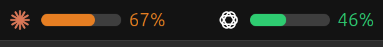

# Claude / Codex Usage Indicator

Extensões do GNOME Shell que mostram, na barra de topo, o uso do **Claude**
(Anthropic) e do **Codex** (OpenAI): uma barra de progresso da sessão de 5h e,
ao clicar, os limites de sessão e semanal com o tempo até ao reset.



## Instalar

```bash
./build-deb.sh
sudo apt install ./build/claude-codex-usage_1.0.0_all.deb
```

Na instalação escolhes **quais** instalar: **Claude**, **Codex** ou **ambos**.

> Em Wayland, termina a sessão e volta a entrar uma vez para as barras
> aparecerem. Depois arrancam sempre em cada login.

## Desinstalar

```bash
sudo apt remove claude-codex-usage
```
